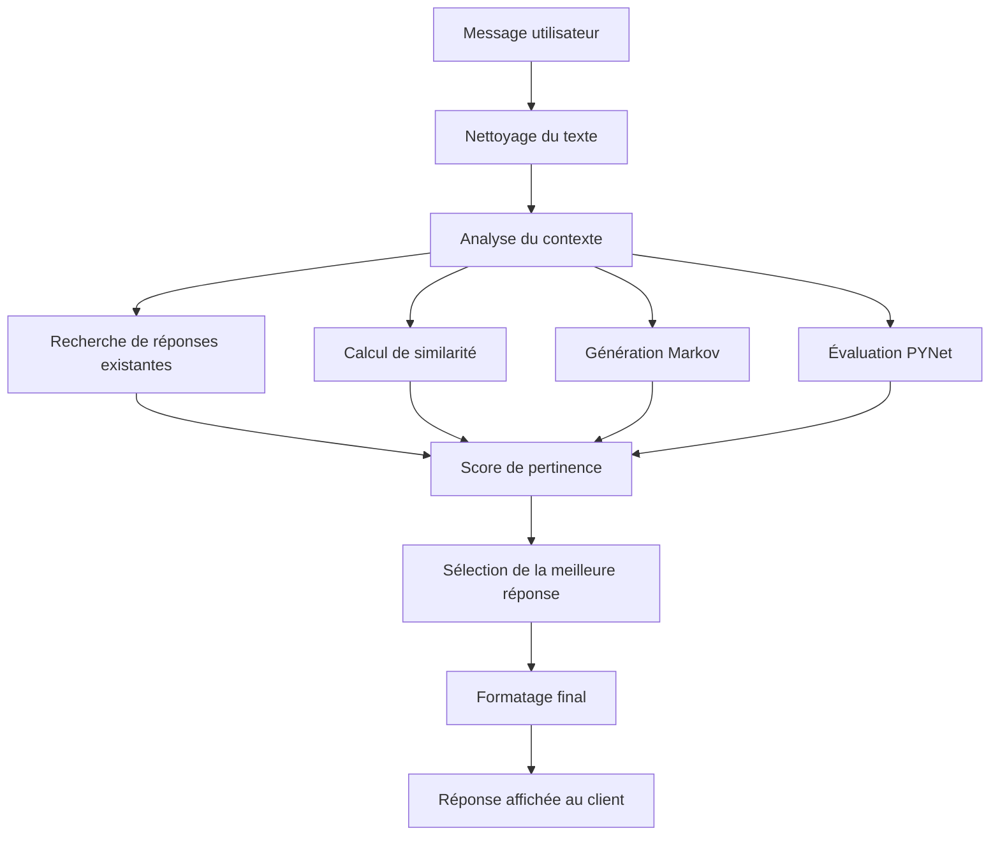
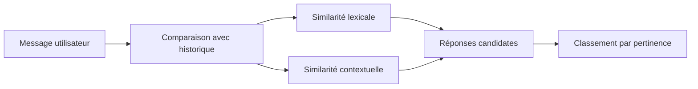
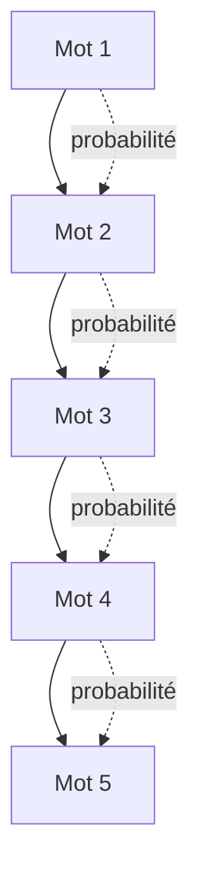
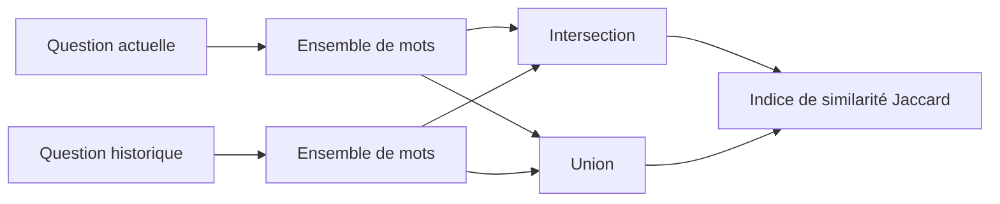
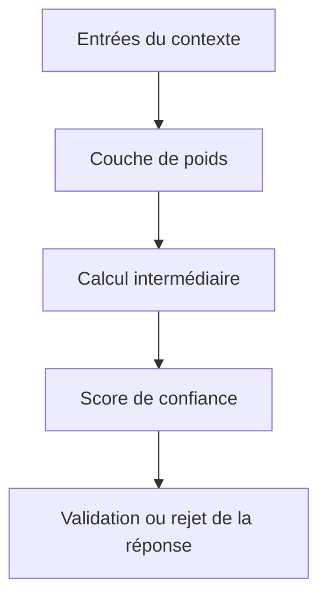
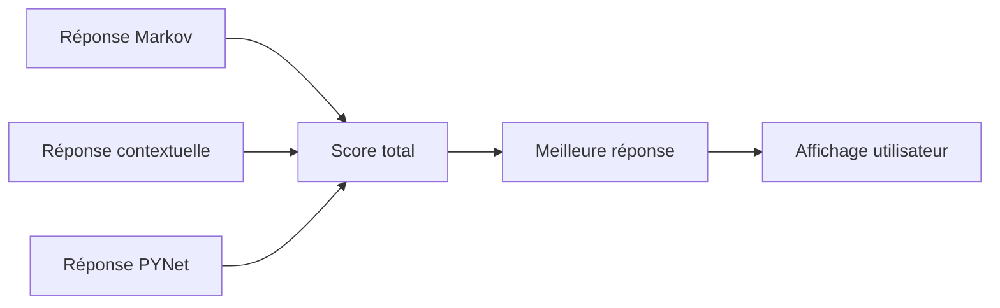
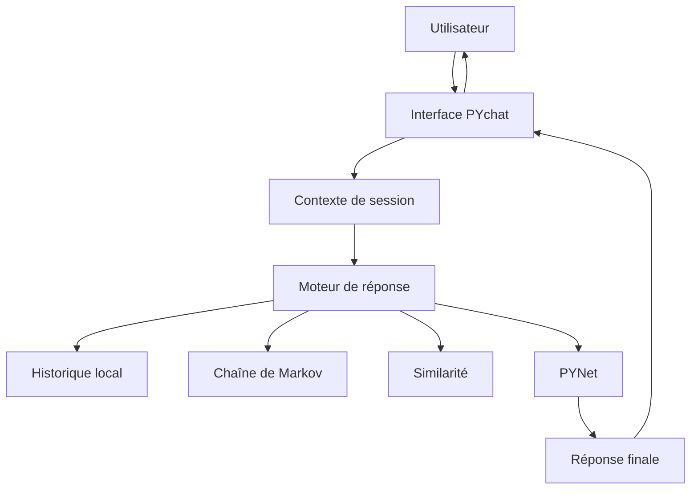

# PYchat 3.5

PYchat est un assistant IA local entièrement conçu en HTML, CSS et JavaScript pour fonctionner directement dans le navigateur. Il est conçu pour fonctionner hors ligne, sans serveur, sans compte, sans dépendance externe et sans transmettre les conversations à un service distant.

La version actuelle est la 3.5 et s’exécute via le fichier principal `PYchat3.0.5.html`. Elle combine une interface moderne de type assistant, un historique de discussion, un mode vocal, un laboratoire d’expérimentation et plusieurs moteurs de génération de réponses.

## Vue d’ensemble

PYchat répond à un besoin simple : fournir un chatbot local, léger, 100 % JavaScript, entièrement portable et facile à lancer. L’idée est de rester performant sur des ordinateurs modestes tout en offrant un comportement assez riche pour des conversations simples à complexes.

Le projet repose sur plusieurs approches :

- réponse par correspondance contextuelle
- génération probabiliste via chaînes de Markov
- comparaison de similarité avec des méthodes Jaccard
- moteur interne de type réseau neuronal simplifié (PYNet)
- interface de chat moderne pour un usage quotidien

## Fonctionnalités

- IA locale 100 % côté client
- Interface moderne de type assistant web
- Historique des conversations avec recherche rapide
- Création, suppression et renommage de discussions
- Mode vocal (dictée + synthèse vocale)
- Thèmes clair / sombre / système
- Gestion avancée des paramètres de génération
- Laboratoire expérimental PYNet
- Import / export des conversations
- Compatible avec les navigateurs modernes
- Sans backend ni dépendance côté serveur

## Structure du projet

- `PYchat3.0.5.html` : application principale
- `README.md` : documentation du projet
- `LICENSE` : licence MIT

## Installation

1. Téléchargez le fichier `PYchat3.0.5.html`
2. Ouvrez-le dans votre navigateur web
3. Commencez à discuter immédiatement

Aucune installation spéciale n’est requise.

## Utilisation

### Chat principal

- Saisissez un message dans la zone de dialogue
- PYchat analyse le contexte et cherche des réponses pertinentes
- La réponse est générée selon le moteur actif (Markov, similarité, réseau interne, ou combinaison)
- L’historique conserve les échanges et permet de retrouver des discussions précédentes

### Mode vocal

Le mode vocal permet :

- de dicter un message via le microphone
- de transformer la réponse en voix synthétique
- de travailler sans clavier dans plusieurs cas d’usage simples

### Paramètres avancés

La version 3.5 inclut un ensemble de réglages pour ajuster le comportement de l’IA :

- seuil de bascule entre moteurs
- longueur des réponses
- ordre de la chaîne de Markov
- activation des suggestions contextuelles
- mode de génération plus ou moins créatif
- réglage du réseau interne PYNet
- support optionnel d’un modèle local externe (par exemple Ollama)

## Comment fonctionne l’IA

Le cœur du système n’est pas un modèle de langage gigantesque, mais un assemblage de méthodes locales. Le flux de traitement ressemble à ceci :

### 1. Prétraitement du texte

Lorsqu’un utilisateur envoie un message, le système nettoie le texte :

- normalisation des accents / espaces
- réduction des variations de casse
- séparation des phrases et des mots-clés
- extraction du contexte principal

Cela permet d’identifier les éléments importants de la demande et d’éviter les choses trop bruitées.

### 2. Recherche de réponses similaires

PYchat compare le message avec les échanges précédents et les réponses connues. Cette étape repose sur des indices de proximité et de similarité.

### 3. Chaîne de Markov

La génération probabiliste repose sur des séquences de mots ou de groupes de mots. L’algorithme construit des transitions entre éléments linguistiques, puis choisit une continuation plausible selon les probabilités déjà apprises.

D’un point de vue pratique, cela permet d’obtenir des réponses qui sonnent naturellement sans devoir reconstruire un modèle plein de règles explicites.

### 4. Similarité Jaccard et contextuelle

La similarité de Jaccard compare les ensembles de mots entre la question actuelle et les questions mémorisées. Si deux messages partagent beaucoup de termes, la réponse associée est plus susceptible d’être correcte.

Le système peut aussi utiliser d’autres indices de contexte pour améliorer la pertinence, notamment avec l’historique récent et les thèmes mentionnés dans le dialogue.

### 5. PYNet, le moteur interne

PYNet est un mécanisme interne de référence, proche d’un réseau neuronal simplifié, utilisé pour évaluer la vraisemblance ou la pertinence d’une réponse selon les signaux du contexte. Il ne remplace pas un LLM classique, mais il apporte une couche de logique locale et d’évaluation des réponses générées.

Le moteur est conçu pour rester léger, simple à calibrer et adapté à une exécution navigateur.

### 6. Sélection de la réponse finale

Un message peut être traité conjointement par plusieurs modules. Chaque module produit une réponse ou un score. Ensuite, le système compare ces résultats et choisit la proposition la plus cohérente.

Ce mode de combinaison permet de limiter les erreurs brutales et d’améliorer la stabilité générale du chatbot.

## Architecture logique

L’application est pensée comme un client autonome qui stocke ses données localement dans le navigateur et gère l’intelligence locale sans dépendre d’un backend.

## Avantages

- zéro dépendance côté serveur
- exécution locale et rapide
- faible consommation de ressources
- facile à déployer et à modifier
- compatible avec le stockage local du navigateur
- adapté à l’apprentissage, l’expérimentation et la personnalisation

## Limites

Comme toute IA locale légère, PYchat reste orientée vers des usages conviviaux et des conversations courtes à moyennes. Les réponses peuvent :

- être moins riches qu’un grand modèle d’IA en ligne
- dépendre fortement de la qualité des données historiques
- nécessiter un réglage manuel pour optimiser la génération
- produire des formulations parfois répétitives si le contexte est pauvre

## Cas d’usage

PYchat est bien adapté à :

- l’expérimentation de logique de chatbot local
- la prototypage rapide d’interface de conversation
- les démos sans fournisseur cloud
- les applications documentaires ou éducatives légères
- les projets pédagogiques sur l’IA locale

## Sécurité et confidentialité

PYchat ne dépend pas d’un service externe pour traiter les messages. Cela signifie que :

- les conversations restent dans l’environnement local
- les données ne sont pas envoyées automatiquement vers un serveur distant
- l’application peut être utilisée dans des contextes où la confidentialité est importante

Toutefois, l’utilisateur reste responsable de la manière dont il stocke ou partage les données dans sa propre navigation et sur son système.

## Licence

Ce projet est distribué sous licence MIT. Voir le fichier [LICENSE](./LICENSE).

---

Créé par [@goby69-code](https://github.com/goby69-code)
