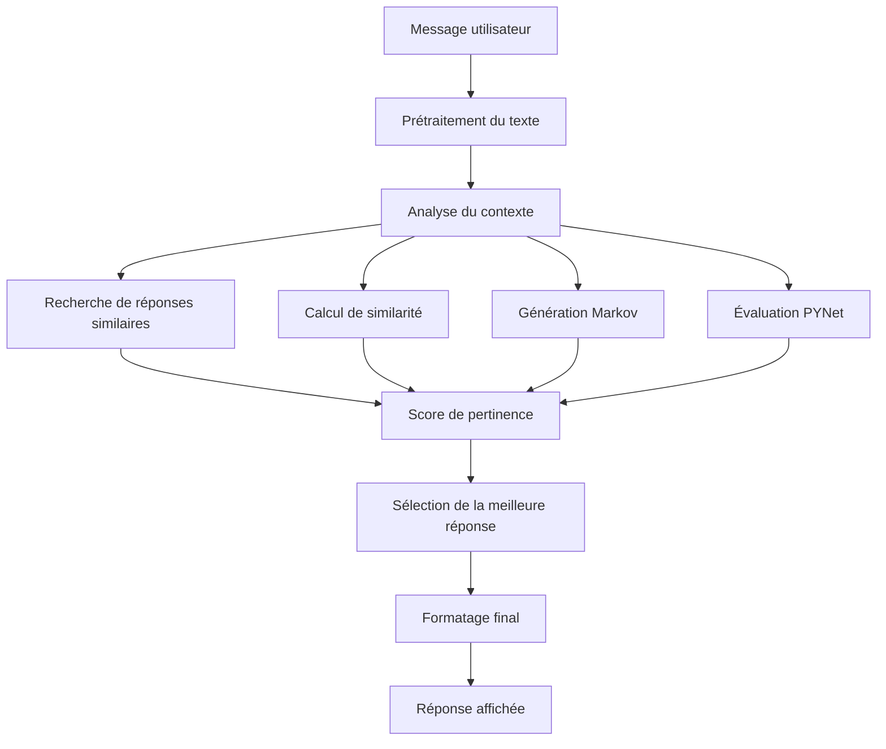
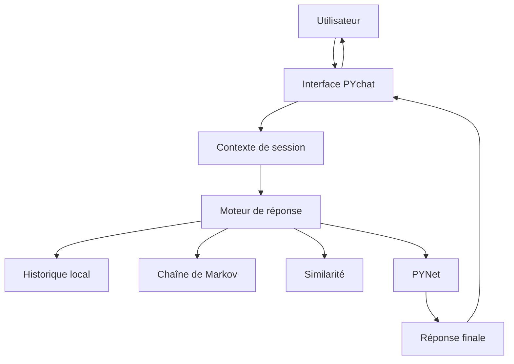

# PYchat 3.8.0

PYchat est un assistant IA local entièrement conçu en HTML, CSS et JavaScript pour fonctionner directement dans le navigateur. Il fonctionne hors ligne, sans backend, sans compte et sans dépendance serveur.

La version actuelle est la 3.8.0 et s’exécute via le fichier principal `PYchat3.8.0.html`. Elle apporte une interface plus lisible, un historique de discussions évolué, un laboratoire interne PYNet plus complet et de nombreux réglages avancés pour personnaliser le comportement du chatbot.

## Vue d’ensemble

PYchat répond à un besoin simple : proposer un chatbot local, léger, portable et facile à lancer, sans dépendre d’un service cloud. L’objectif est de rester performant sur des machines modestes tout en offrant une expérience proche d’un assistant moderne.

Le projet combine plusieurs approches :

- correspondance contextuelle
- génération probabiliste par chaînes de Markov
- comparaison de similarité via Jaccard et autres indices contextuels
- moteur interne PYNet
- interface de discussion moderne et personnalisable

## Fonctionnalités

- IA locale 100 % côté client
- Interface web moderne de type assistant
- Historique de discussions avec recherche rapide
- Création, suppression et renommage de conversations
- Import / export des conversations
- Mode vocal (dictée + lecture vocale)
- Thèmes clair / sombre / système
- Paramètres avancés pour ajuster le moteur de réponse
- Laboratoire expérimental PYNet
- Support optionnel d’un modèle local externe via Ollama
- Compatible avec les navigateurs modernes
- Sans backend ni dépendance serveur

## Structure du projet

- `PYchat3.8.0.html` : application principale
- `README.md` : documentation du projet
- `LICENSE` : licence MIT

## Installation

1. Téléchargez le fichier `PYchat3.8.0.html`
2. Ouvrez-le dans votre navigateur web
3. Commencez à discuter immédiatement

Aucune installation spéciale n’est requise.

## Utilisation

### Chat principal

- Saisissez un message dans la zone de dialogue
- PYchat analyse le contexte et cherche des réponses pertinentes
- La réponse est générée selon le moteur actif (similarité, Markov, PYNet, ou combinaison)
- L’historique conserve les échanges et permet de retrouver des discussions passées

### Historique et conversations

- Créez une nouvelle discussion
- Renommez ou supprimez une conversation
- Recherchez rapidement dans l’historique
- Exportez ou importez vos échanges pour les sauvegarder ou les réutiliser

### Mode vocal

Le mode vocal permet de :

- dicter un message via le microphone
- faire lire les réponses à haute voix
- interagir sans clavier dans des usages simples

### Paramètres avancés

La version 3.8.0 inclut un jeu de réglages pour personnaliser le comportement du chatbot :

- seuil de bascule entre les moteurs
- longueur des réponses
- ordre de la chaîne de Markov
- activation des suggestions contextuelles
- niveau de créativité
- réglage du moteur interne PYNet
- support optionnel d’un modèle local externe (Ollama)

## Comment fonctionne l’IA

Le cœur de PYchat n’est pas un grand modèle de langage distant, mais un assemblage de méthodes locales. Le traitement d’un message suit généralement ce schéma :

### 1. Prétraitement du texte

Lorsqu’un utilisateur envoie un message, le système nettoie le texte pour :

- normaliser les accents et les espaces
- réduire les variations de casse
- séparer les mots-clés et les éléments utiles
- extraire le contexte principal

### 2. Recherche de réponses similaires

PYchat compare le message avec les historiques et les réponses mémorisées. Cette étape repose sur la proximité et la similarité contextuelle.

### 3. Chaîne de Markov

La génération probabiliste s’appuie sur des séquences de mots ou de groupes de mots. L’algorithme construit des transitions entre éléments linguistiques puis choisit une continuation plausible selon les probabilités observées.

### 4. Similarité Jaccard et contexte

La similarité de Jaccard compare les ensembles de mots entre la question actuelle et les questions mémorisées. Plus les termes se recouvrent, plus la réponse associée a de chances d’être pertinente. Le système peut aussi intégrer des indices contextuels comme le dernier historique ou les thèmes abordés.

### 5. PYNet, le moteur interne

PYNet est un moteur interne de type réseau neuronal simplifié, conçu pour évaluer la pertinence ou la vraisemblance d’une réponse selon le contexte. Il est pensé pour rester léger, compréhensible et compatible avec un usage navigateur.

### 6. Sélection de la réponse finale

Un message peut être évalué par plusieurs modules à la fois. Chacun produit une réponse ou un score. Le système compare ensuite ces résultats et choisit la proposition la plus cohérente à afficher à l’utilisateur.

## Architecture logique

L’application est pensée comme un client autonome qui stocke ses données localement dans le navigateur et gère l’intelligence locale sans dépendre d’un backend.

## Avantages

- zéro dépendance côté serveur
- exécution locale et rapide
- faible consommation de ressources
- facile à déployer et à modifier
- compatible avec le stockage local du navigateur
- adapté à l’expérimentation, l’apprentissage et la personnalisation

## Limites

Comme toute IA locale légère, PYchat reste orientée vers des usages conviviaux et des conversations courtes à moyennes. Les réponses peuvent :

- être moins riches qu’un grand modèle d’IA en ligne
- dépendre fortement de la qualité des données historiques
- nécessiter un réglage manuel pour optimiser la génération
- produire des formulations parfois répétitives si le contexte est pauvre

## Cas d’usage

PYchat convient bien à :

- l’expérimentation de chatbot local
- le prototypage rapide d’interfaces de conversation
- les démonstrations sans fournisseur cloud
- les projets pédagogiques sur l’intelligence locale
- les applications documentaires ou éducatives légères

## Sécurité et confidentialité

PYchat ne dépend pas d’un service externe pour traiter les messages. Cela signifie que :

- les conversations restent dans l’environnement local
- les données ne sont pas envoyées automatiquement vers un serveur distant
- l’application peut être utilisée dans des contextes où la confidentialité est importante

Toutefois, l’utilisateur reste responsable de la manière dont il stocke ou partage les données dans son navigateur et sur son système.

## Licence

Ce projet est distribué sous licence MIT. Voir le fichier [LICENSE](./LICENSE).

---

Créé par [@goby69-code](https://github.com/goby69-code)
